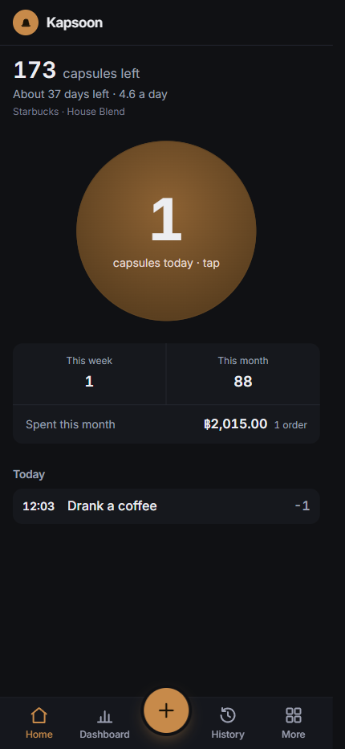

# Kapsoon

Tracks a capsule coffee stash: what's left, how fast it's going, and what it costs. Mobile-first,
dark-mode, installable PWA on Next.js 16. Single-user, offline-first, no accounts — the data lives
on the device. See [PRODUCT.md](PRODUCT.md) for who it's for and [DESIGN.md](DESIGN.md) for the
visual system.

## Scripts

- `npm run dev` — dev server (add `-- -H 0.0.0.0` to test on your phone over LAN)
- `npm run typecheck` · `npm run lint` · `npm run format` · `npm test` · `npm run build`
- `npm run deploy` / `npm run deploy:prod` — preview / production deploy

## Data layer

Real SQL in the browser: [SQLocal](https://sqlocal.dev) (`@sqlite.org/sqlite-wasm`) persists to
OPFS and is queried through `drizzle-orm/sqlite-proxy` — see `src/features/coffee/db.ts` and
`schema.ts`. No server, no account, no sync conflicts.

**OPFS requires the page to be cross-origin isolated**, so `next.config.ts` serves
`Cross-Origin-Embedder-Policy: require-corp` and `Cross-Origin-Opener-Policy: same-origin` on every
route. Removing those headers breaks persistence silently — the app renders with empty stock rather
than erroring. Solid on Android/Chrome; weaker on iOS Safari.

Backup is a JSON export of the movement log (`src/features/coffee/backup.ts`), written as `.txt`
rather than `.json` so Android's share sheet accepts it — the bytes are JSON either way.

## Deploy

Vercel, linked to the `kapsoon` project. This checkout has **no git remote**, so deploys are
CLI-driven from here (`npm run deploy:prod`) rather than push-to-build. The code exists only on
this machine — the deployed build is not a backup.
