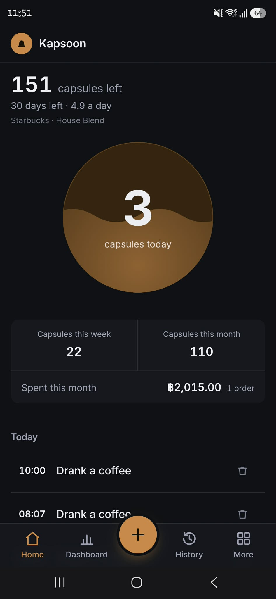

# Kapsoon

Tracks a capsule coffee stash: what's left, how fast it's going, and what it costs. Mobile-first,
dark-mode, installable PWA on Next.js 16. Single-user, offline-first, no accounts — the data lives
on the device. See [PRODUCT.md](PRODUCT.md) for who it's for and [DESIGN.md](DESIGN.md) for the
visual system.



## Getting started

```bash
npm install
npm run dev        # add `-- -H 0.0.0.0` to open it on your phone over LAN
```

First run seeds a small **synthetic sample** (`public/coffee-seed.json`) so the app has something to
show; your own data lives in the browser's OPFS and never leaves the device. To move data between
devices, use the in-app backup (file export or Google Drive) and restore.

## Scripts

- `npm run dev` — dev server (add `-- -H 0.0.0.0` to test on your phone over LAN)
- `npm run typecheck` · `npm run lint` · `npm run format` · `npm test` · `npm run build`
- `npm run deploy` / `npm run deploy:prod` — preview / production deploy

## Data layer

Real SQL in the browser: [SQLocal](https://sqlocal.dev) (`@sqlite.org/sqlite-wasm`) persists to
OPFS and is queried through `drizzle-orm/sqlite-proxy` — see `src/features/coffee/db.ts` and
`core/schema.ts`. No server, no account, no sync conflicts.

The domain itself lives in `src/features/coffee/core/` and is deliberately platform-free: the
movement type, every pure reducer (stock, runway, spend), stats, backup serialization and the
schema, none of which import a browser API. `db.ts` imports _from_ core, never the reverse, so the
logic stays reusable outside a browser. `core/boundary.test.ts` enforces that.

**OPFS requires the page to be cross-origin isolated**, so `next.config.ts` serves
`Cross-Origin-Embedder-Policy: require-corp` and `Cross-Origin-Opener-Policy: same-origin` on every
route. Removing those headers breaks persistence silently — the app renders with empty stock rather
than erroring. Solid on Android/Chrome; weaker on iOS Safari.

## Backup

There is no server, so the on-device log is the only copy — two ways to protect it:

- **File export/restore** (`src/features/coffee/backup.ts`): a JSON snapshot of the movement log,
  written as `.txt` rather than `.json` so Android's share sheet accepts it (the bytes are JSON
  either way).
- **Google Drive** (`src/features/coffee/drive/`): optional client-side backup to the user's own
  Drive via the OAuth implicit **redirect** flow and the `drive.file` REST API — no backend, no
  refresh token. (Not the GIS popup: COOP `same-origin` severs the popup's opener, so it never
  delivers a token.) Inert until `NEXT_PUBLIC_GOOGLE_CLIENT_ID` is set; see that file's
  `client-id.ts`, and list your dev/prod origins (e.g. `https://kapsoon.vercel.app`,
  `http://localhost:3000`, no trailing slash) under both **Authorized JavaScript origins** and
  **Authorized redirect URIs**.

## Deploy

Deploys to Vercel (`npm run deploy:prod`, or connect the repo for push-to-build). Set
`NEXT_PUBLIC_GOOGLE_CLIENT_ID` in the project env if you want Drive backup enabled (it's inlined at
build time — redeploy after changing it).

## License

MIT — see [LICENSE](LICENSE).
